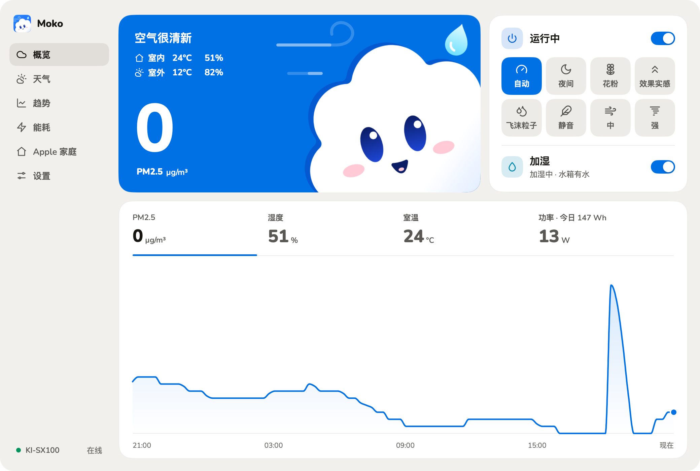
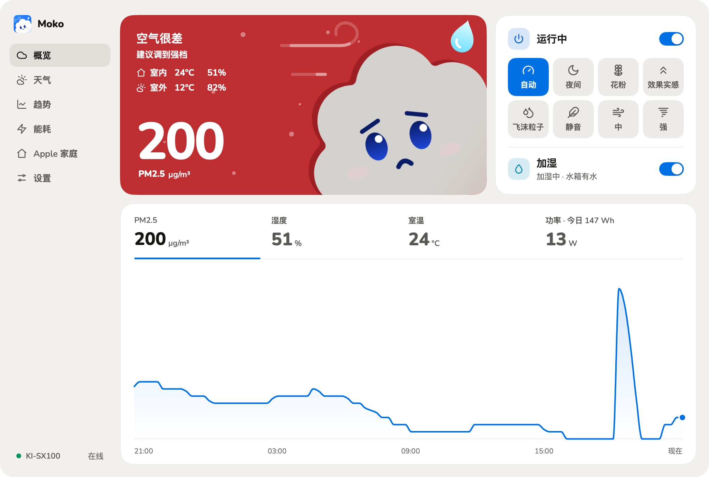
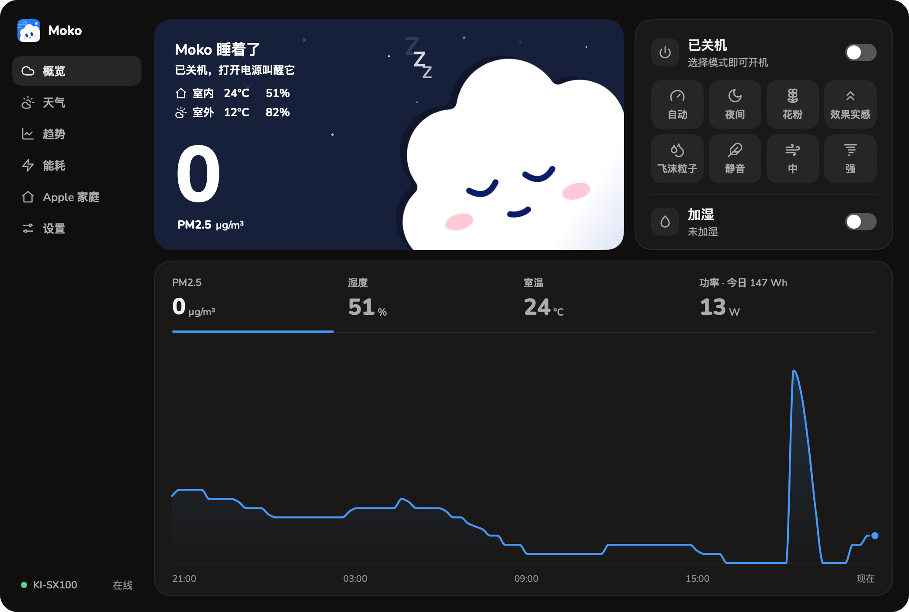
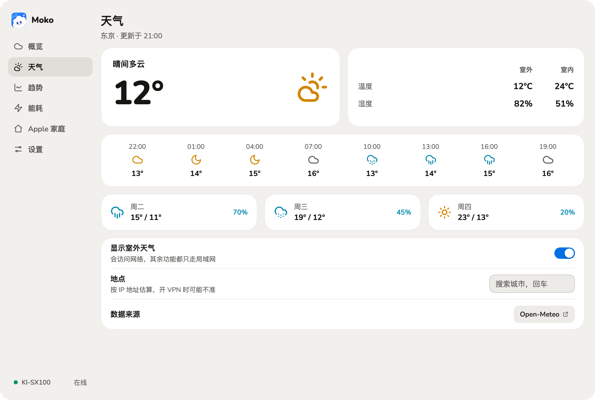
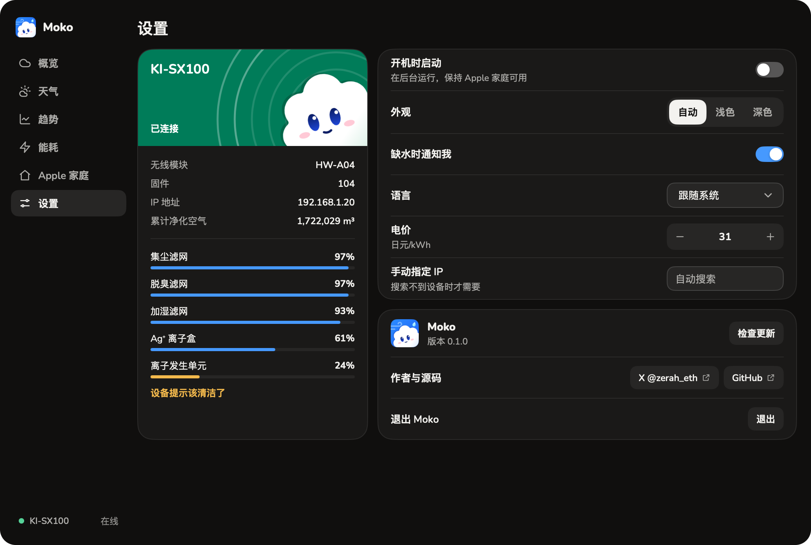

<div align="center">
  
  <h1>Moko</h1>
  <p><strong>在 Mac 和 Windows 上查看和控制夏普 KI-SX100 加湿空气净化器。</strong></p>
  <p><a href="https://qzz0518.github.io/moko/">官网</a></p>
  <p>简体中文 · <a href="README_EN.md">English</a> · <a href="README_JA.md">日本語</a></p>
  <p>
    <a href="https://github.com/qzz0518/moko/stargazers"></a>
    
    
    
    <a href="LICENSE"></a>
    <a href="https://x.com/zerah_eth"></a>
  </p>
</div>

<p align="center">
  
</p>

Moko 是界面里那朵云，名字来自日语「もこもこ」（软绵绵）。它的表情和天空的颜色跟着空气走，一眼就知道屋里空气怎么样。

Moko 直接通过局域网和净化器通信（ECHONET Lite），**不需要账号，也不经过云**。

> [!IMPORTANT]
> Moko 是独立项目，与夏普无关联、未获其背书。夏普没有公开这些私有属性的格式，这里的解读来自实机观察，在一台 KI-SX100（无线模块 HW-A04、固件 104）上验证，详见 [docs/device-echonet.md](docs/device-echonet.md)。

## 功能

- **空气状态**：PM2.5、室温、湿度、功率，点读数切换过去 24 小时的曲线。天空和 Moko 的表情随空气变化，风线的流速跟着风量走。
- **控制**：电源、八个运行模式（自动、夜间、花粉、效果实感、飞沫粒子、静音、中、强）、加湿。每次操作都会回读确认，失败时退回真实状态。
- **耗材**：集尘滤网、脱臭滤网、加湿滤网、Ag+ 离子盒、离子发生单元的剩余寿命，和 COCORO AIR 显示的一致。
- **能耗与趋势**：每天用电和电费（电价可改）、累计和每日净化空气量，PM2.5、湿度、温度最长 30 天的趋势。
- **室外天气**：当地天气、室内外对比、未来 24 小时和 3 天预报。可以关闭。
- **Apple 家庭**：扫码加入“家庭” App，控制净化和加湿，查看空气质量、室温、滤网寿命，可用 Siri 和自动化。
- **托盘面板**：不打开主窗口也能完成日常操作。缺水时提醒。
- 浅色和深色外观，中文、日文、英文，应用内更新（更新包经签名校验）。

<table>
  <tr>
    <td></td>
    <td></td>
  </tr>
  <tr>
    <td></td>
    <td></td>
  </tr>
</table>

## 系统要求

- Apple 芯片的 Mac，macOS 13 及以上；或 Windows 10/11（x64）。
- 夏普 KI-SX100，已用 COCORO AIR App 连上 Wi-Fi，并和电脑在同一个局域网。

其他夏普机型可能也能用，但字段可能不同，欢迎[反馈](https://github.com/qzz0518/moko/issues)。

## 安装

在 [Releases](https://github.com/qzz0518/moko/releases/latest) 下载：

- **macOS**：打开 `.dmg`，把 Moko 拖进“应用程序”。已用 Developer ID 签名并经 Apple 公证。
- **Windows**：运行名字里带 `setup` 的 `.exe`，不需要管理员权限。安装包暂未做代码签名，SmartScreen 拦截时点“更多信息 → 仍要运行”。

## 上手

1. 打开 Moko。它会自动在局域网里搜索净化器。
2. 第一次打开时 macOS 会询问是否允许访问本地网络，请选择允许；Windows 上按提示放行防火墙（需要确认一次管理员权限）。
3. 关闭窗口后 Moko 留在菜单栏或托盘，点云朵图标打开面板。要完全退出，请用 设置 → 退出，或右键图标。

### Apple 家庭

1. 打开 **Apple 家庭** 页的开关，下面会显示二维码和配对码。
2. 在 iPhone 的“家庭” App 里点“添加配件”，扫描二维码。提示“未认证配件”时选“仍然添加”。

运行 Moko 的电脑要保持唤醒并开着 Moko，否则“家庭”里会显示“无响应”。**一个家只需要在一台电脑上打开。**

## 隐私

- 控制和读数只走局域网，没有 Moko 服务器，不收集使用数据，也不需要账号。
- 历史读数和设置只存在这台电脑上。
- 需要访问互联网的只有三处：
  - **更新**：从本仓库的 GitHub Releases 检查和下载。
  - **天气**（可关闭）：把地点的经纬度发给 [Open-Meteo](https://open-meteo.com/)。
  - **估算位置**（可避免）：没有手动选地点时，向 ipwho.is（失败时 ipapi.co）查询，对方能看到你的公网 IP。在天气页手动选一个地点，或关闭天气，就不会再查询。

## 排障

- **找不到净化器**：确认它已用 COCORO AIR 连上 Wi-Fi，电脑和它在同一个局域网；macOS 在 系统设置 › 隐私与安全性 › 本地网络 里允许 Moko；Windows 把当前网络设为“专用网络”。路由器过滤多播时，在设置里手动填净化器的 IP。
- **同一台电脑只能跑一个 ECHONET 程序**：设备只回复到 UDP 3610，其他同类程序会抢端口。
- **天气的地点不对**：开着 VPN 时按 IP 估算会偏，在天气页手动选地点。搜不到中文或日文地名时试试英文名。

设置保存在 `~/Library/Application Support/Moko/`（Windows：`%AppData%\Moko\`）。

## 从源码构建

需要 Go 1.27.3 或以上，不需要 cgo，一台 Mac 可以交叉编译两个平台。

```sh
git clone https://github.com/qzz0518/moko.git
cd moko
go tool mygo dev   # 运行
go test ./...
```

打包和贡献说明见 [CONTRIBUTING.md](CONTRIBUTING.md)，协议和字段见 [docs/](docs/)。

## 致谢与许可

Moko 基于 [MyGo](https://github.com/egoist/mygo) 构建，Apple 家庭支持来自 [hap](https://github.com/brutella/hap)，天气数据来自 [Open-Meteo](https://open-meteo.com/)（CC BY 4.0），界面字体是 [Nunito](https://github.com/googlefonts/nunito)。设备字段参考了 [waszkowski/homeassistant-sharp-cocoro-air](https://github.com/waszkowski/homeassistant-sharp-cocoro-air) 等项目，实现为独立编写，详见 [THIRD-PARTY-NOTICES.md](THIRD-PARTY-NOTICES.md)。

代码以 [MIT License](LICENSE) 发布。KI-SX100、COCORO AIR、Plasmacluster 和 SHARP 是夏普的商标。

- [在 X 关注 @zerah_eth](https://x.com/zerah_eth)
