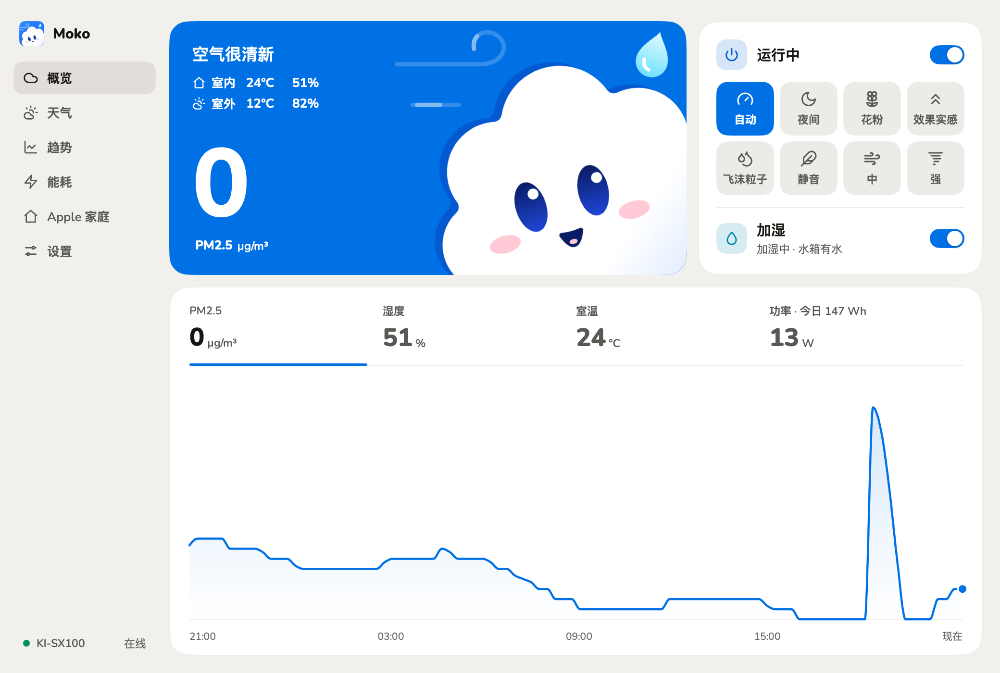
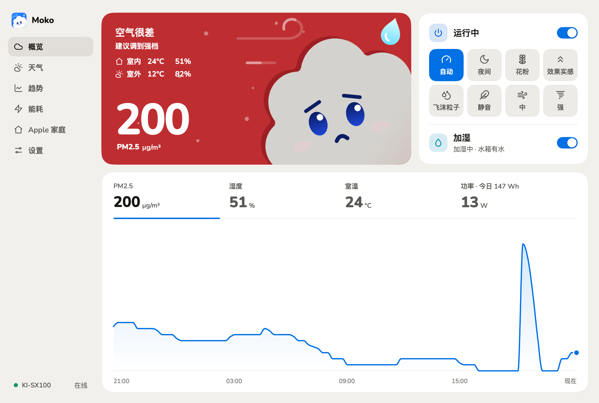
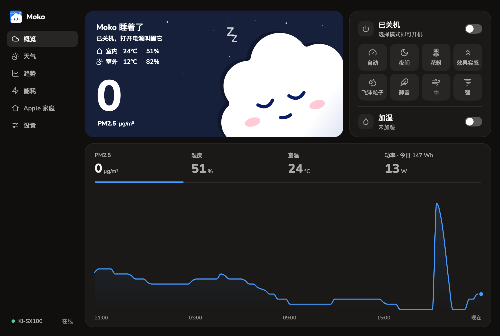
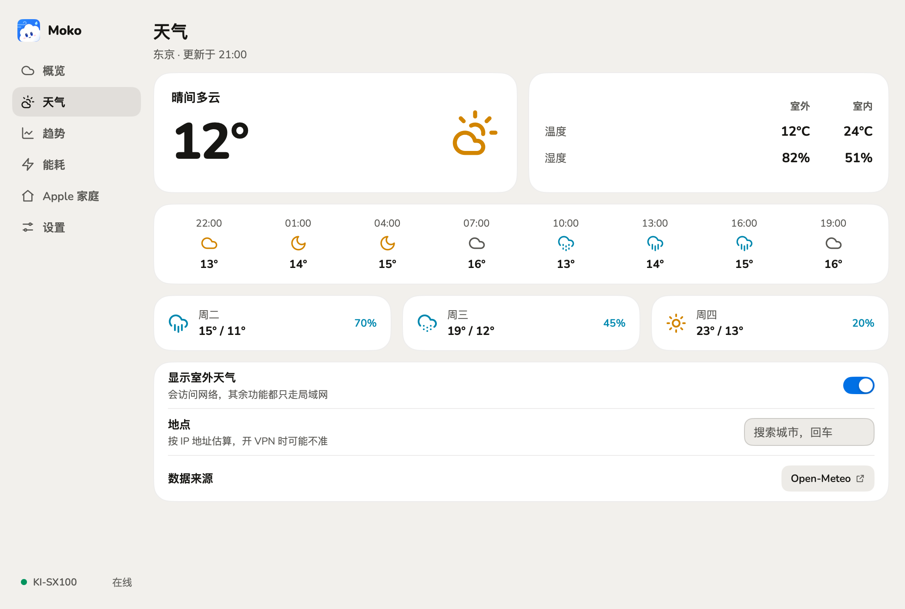
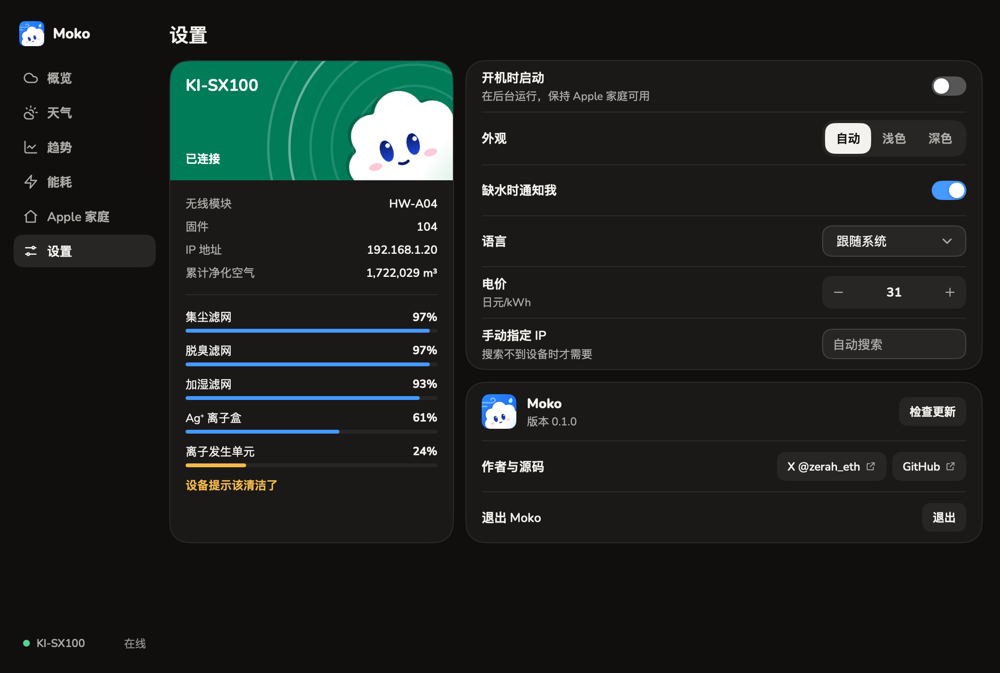

<div align="center">
  
  <h1>Moko</h1>
  <p><strong>View and control a Sharp KI-SX100 humidifying air purifier from your Mac or Windows PC.</strong></p>
  <p><a href="README.md">简体中文</a> · English</p>
  <p>
    <a href="https://github.com/qzz0518/moko/stargazers"></a>
    
    
    
    <a href="LICENSE"></a>
    <a href="https://x.com/zerah_eth"></a>
  </p>
</div>

<p align="center">
  
</p>

Moko is the cloud in the app, named after the Japanese もこもこ, soft and fluffy. Its face and the color of its sky follow the air, so a glance tells you how the air in the room is.

Moko talks to the purifier directly over your local network (ECHONET Lite), **with no account and no cloud**.

> [!IMPORTANT]
> Moko is an independent project, not affiliated with or endorsed by Sharp. Sharp does not document these private properties. What Moko reads of them comes from watching a real device, and has been confirmed on one KI-SX100 only (wireless module HW-A04, firmware 104): temperature, humidity and consumables were compared with the official COCORO AIR app, and changing modes (auto, quiet) and humidifying were written to the device. **Power and the other modes have not been written to a real device yet, control through Apple Home has not been verified, and the Windows version has not run on a real machine yet.** See [docs/device-echonet.md](docs/device-echonet.md).

## Features

- **The air**: PM2.5, temperature, humidity and power; click a reading to chart its last 24 hours. The sky and Moko's face change with the air, and the wind in the sky moves at the fan's pace.
- **Control**: power, eight modes (auto, night, pollen, boost, droplets, quiet, medium, high) and humidifying. Each change is read back, and shows the real state if it fails.
- **Consumables**: what is left of the dust, deodorizing and humidifying filters, the Ag+ cartridge and the ion unit, matching COCORO AIR.
- **Energy and trends**: energy use and cost per day (set your own price), air cleaned in total and per day, and PM2.5, humidity and temperature over up to 30 days.
- **The weather outside**: local conditions, outdoors against indoors, and the next 24 hours and 3 days. It can be turned off.
- **Apple Home**: add it by QR code to control purifying and humidifying, and see air quality, temperature and filter life, with Siri and automations.
- **Tray panel**: everything for daily use without the main window, and a notification when the tank runs out.
- Light and dark appearance, Chinese, Japanese and English, in-app updates with signed packages.

<table>
  <tr>
    <td></td>
    <td></td>
  </tr>
  <tr>
    <td></td>
    <td></td>
  </tr>
</table>

## Requirements

- A Mac with Apple silicon on macOS 13 or later, or Windows 10/11 (x64).
- A Sharp KI-SX100 on Wi-Fi, set up with the COCORO AIR app, on the same network as the computer.

Other Sharp models may work, but their fields may differ. [Reports](https://github.com/qzz0518/moko/issues) are welcome.

## Install

Download from [Releases](https://github.com/qzz0518/moko/releases/latest):

- **macOS**: open the `.dmg` and drag Moko to Applications. It is signed with a Developer ID and notarized by Apple.
- **Windows**: run the `.exe` with `setup` in its name; it needs no administrator rights. The installer is not code signed yet: if SmartScreen stops it, choose More info → Run anyway.

## Getting started

1. Open Moko. It searches the local network for the purifier.
2. The first time, macOS asks for access to the local network: allow it. On Windows, follow the prompt to allow it through the firewall (one administrator confirmation).
3. Closing the window leaves Moko in the menu bar or tray; click the cloud for its panel. To quit, use Settings → Quit, or right-click the icon.

### Apple Home

1. Turn on the switch on the **Apple Home** page, which then shows a QR code and a setup code.
2. In the Home app on iPhone, tap Add Accessory and scan the code. If it warns of an uncertified accessory, choose Add Anyway.

The computer must stay awake with Moko running, or Home shows No Response. **Turn this on for one computer in a home.**

## Privacy

- Control and readings stay on the local network. There is no Moko server, no usage data and no account.
- History and settings stay on this computer.
- Only three things use the internet:
  - **Updates**: checked and downloaded from this repository's GitHub Releases.
  - **Weather** (can be turned off): sends the coordinates of the place to [Open-Meteo](https://open-meteo.com/).
  - **Estimating your location** (avoidable): when you have not chosen a place, Moko asks ipwho.is (ipapi.co if that fails), which sees your public IP address. Choose a place on the weather page, or turn the weather off, and it no longer asks.

## Troubleshooting

- **The purifier is not found**: check that it is on Wi-Fi through COCORO AIR, on the same network as the computer. On macOS, allow Moko in System Settings › Privacy & Security › Local Network. On Windows, set the network to Private. If your router filters multicast, enter the purifier's IP address in Settings.
- **Only one ECHONET program per computer**: the device only answers to UDP port 3610, so others like it compete for the port.
- **The weather is for the wrong place**: a VPN throws off the estimate; choose a place on the weather page. If a local name finds nothing, try it in English.

Settings are in `~/Library/Application Support/Moko/` (Windows: `%AppData%\Moko\`).

## Build from source

You need Go 1.27.3 or later, and no cgo. One Mac cross-compiles both platforms.

```sh
git clone https://github.com/qzz0518/moko.git
cd moko
go tool mygo dev   # run it
go test ./...
```

See [CONTRIBUTING.md](CONTRIBUTING.md) for packaging and contributing, and [docs/](docs/) (in Chinese) for the protocol and its fields.

## Credits and license

Moko is built with [MyGo](https://github.com/egoist/mygo), with Apple Home support from [hap](https://github.com/brutella/hap), weather data from [Open-Meteo](https://open-meteo.com/) (CC BY 4.0) and the [Nunito](https://github.com/googlefonts/nunito) font. What the device's fields mean was informed by [waszkowski/homeassistant-sharp-cocoro-air](https://github.com/waszkowski/homeassistant-sharp-cocoro-air) and others; the code is written independently. See [THIRD-PARTY-NOTICES.md](THIRD-PARTY-NOTICES.md).

The code is under the [MIT License](LICENSE). KI-SX100, COCORO AIR, Plasmacluster and SHARP are trademarks of Sharp Corporation.

- [Follow @zerah_eth on X](https://x.com/zerah_eth)
