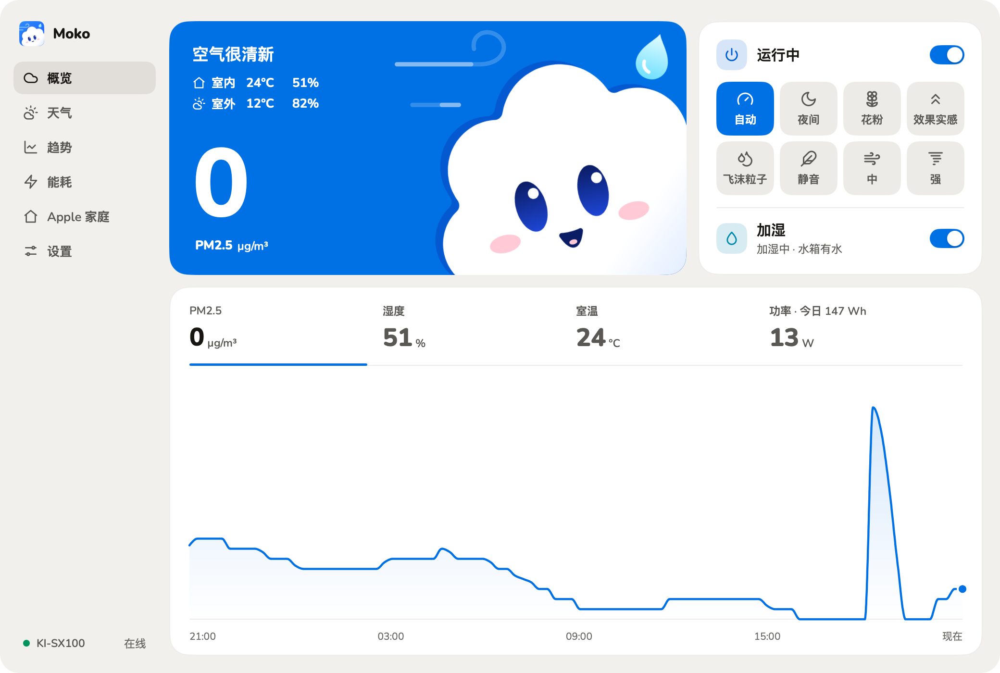
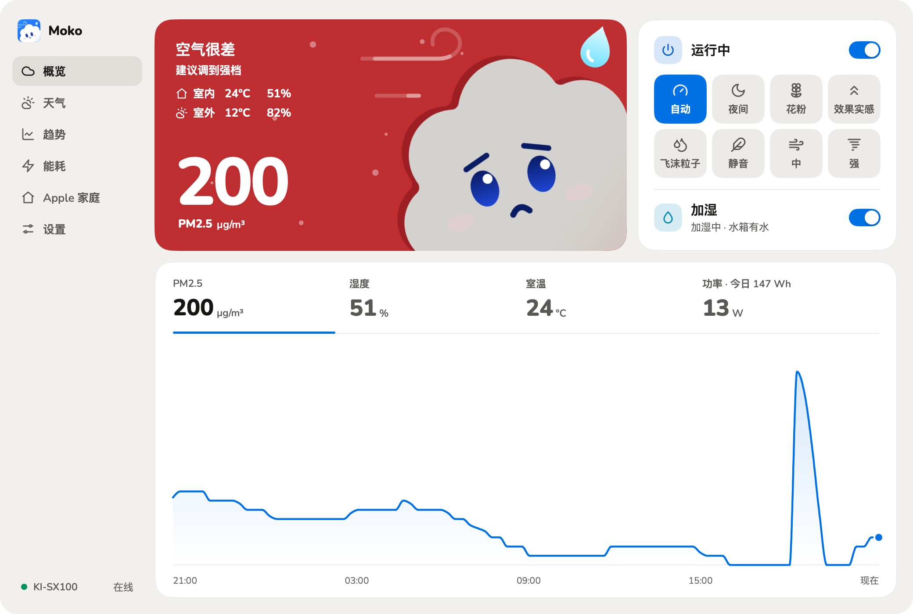
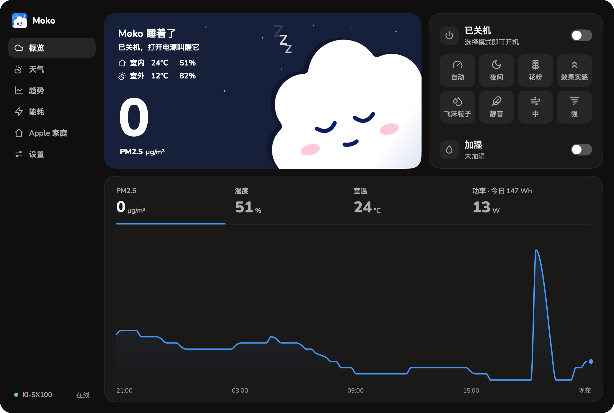
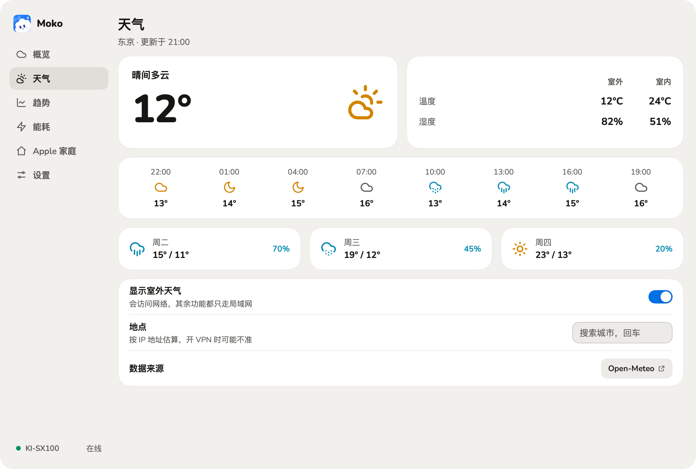
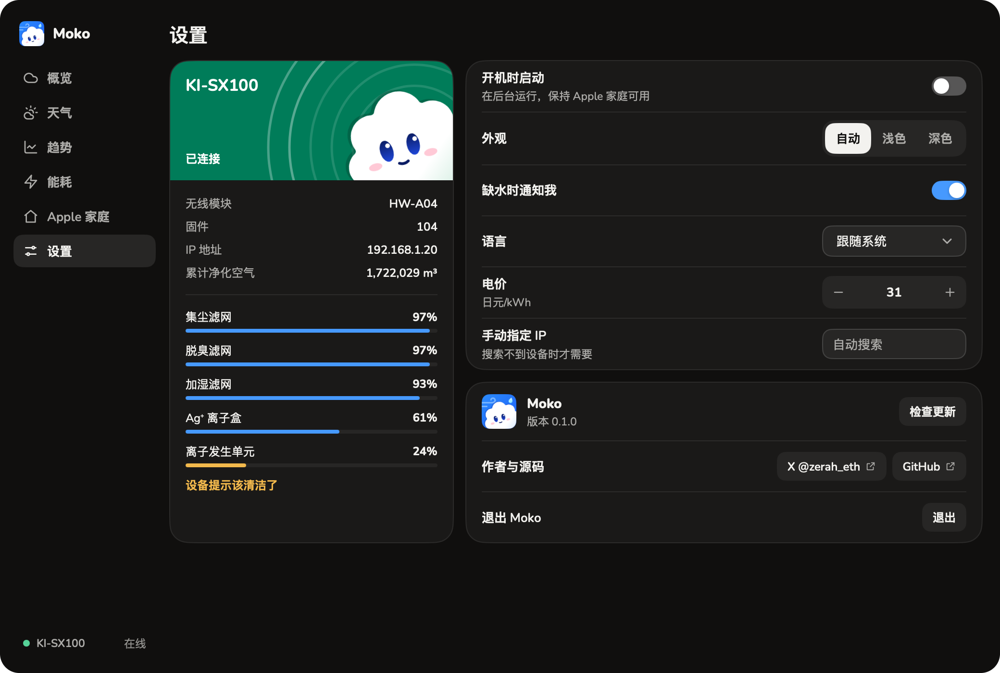

<div align="center">
  
  <h1>Moko</h1>
  <p><strong>シャープの加湿空気清浄機 KI-SX100 を、Mac と Windows で確認・操作できるアプリ。</strong></p>
  <p><a href="https://qzz0518.github.io/moko/">公式サイト</a></p>
  <p><a href="README.md">简体中文</a> · <a href="README_EN.md">English</a> · 日本語</p>
  <p>
    <a href="https://github.com/qzz0518/moko/stargazers"></a>
    
    
    
    <a href="LICENSE"></a>
    <a href="https://x.com/zerah_eth"></a>
  </p>
</div>

<p align="center">
  
</p>

Moko はアプリに登場する雲のキャラクターで、名前は「もこもこ」から。表情と空の色が空気に合わせて変わるので、部屋の空気がひと目でわかります。

Moko はローカルネットワーク上で空気清浄機と直接通信します（ECHONET Lite）。**アカウントは不要で、クラウドも経由しません。**

> [!IMPORTANT]
> Moko は個人による非公式プロジェクトで、シャープとは関係がなく、同社の承認も受けていません。シャープはこれらの独自プロパティの仕様を公開していないため、内容は実機の観察にもとづいており、KI-SX100（無線モジュール HW-A04、ファームウェア 104）1 台で確認しています。詳しくは [docs/device-echonet.md](docs/device-echonet.md)（中国語）をご覧ください。

## 機能

- **空気の状態**：PM2.5、室温、湿度、消費電力。数値をクリックすると過去 24 時間のグラフに切り替わります。空と Moko の表情は空気に合わせて変わり、風の線の速さは風量に連動します。
- **操作**：電源、8 つの運転モード（自動、おやすみ、花粉、効果実感、飛沫粒子、静音、中、強）、加湿。操作のたびに本体から読み戻して確認し、失敗したときは実際の状態に戻します。
- **消耗品**：集じんフィルター、脱臭フィルター、加湿フィルター、Ag+イオンカートリッジ、イオン発生ユニットの残り寿命。COCORO AIR の表示と同じ値です。
- **電力と推移**：1 日ごとの消費電力と電気代（単価は変更できます）、きれいにした空気量の累計と 1 日ごとの量、PM2.5・湿度・温度の最長 30 日の推移。
- **屋外の天気**：現在の天気、室内との比較、この先 24 時間と 3 日間の予報。オフにもできます。
- **Apple ホーム**：QR コードで「ホーム」アプリに追加。空気清浄と加湿の操作、空気質・室温・フィルター寿命の確認、Siri とオートメーションに対応します。
- **トレイパネル**：メインウインドウを開かなくても毎日の操作ができます。水がなくなると通知します。
- ライトとダークの外観、中国語・日本語・英語、アプリ内アップデート（更新パッケージは署名を検証します）。

<table>
  <tr>
    <td></td>
    <td></td>
  </tr>
  <tr>
    <td></td>
    <td></td>
  </tr>
</table>

## 動作環境

- Apple シリコン搭載の Mac（macOS 13 以降）、または Windows 10/11（x64）。
- COCORO AIR アプリで Wi-Fi に接続済みのシャープ KI-SX100。コンピュータと同じローカルネットワーク上にあること。

ほかのシャープ製品でも動く可能性はありますが、項目が異なる場合があります。[ご報告](https://github.com/qzz0518/moko/issues)をお待ちしています。

## インストール

[Releases](https://github.com/qzz0518/moko/releases/latest) からダウンロードしてください。

- **macOS**：`.dmg` を開き、Moko を「アプリケーション」にドラッグします。Developer ID で署名し、Apple の公証を受けています。
- **Windows**：名前に `setup` が付いた `.exe` を実行します。管理者権限は不要です。インストーラーにはまだコード署名がないため、SmartScreen に止められたら「詳細情報 → 実行」を選んでください。

## はじめかた

1. Moko を開くと、ローカルネットワーク上の空気清浄機を自動で探します。
2. 初回は macOS がローカルネットワークへのアクセスを確認するので、許可してください。Windows では案内に従ってファイアウォールを許可します（管理者の確認が 1 回必要です）。
3. ウインドウを閉じても Moko はメニューバーやトレイに残ります。雲のアイコンをクリックするとパネルが開きます。完全に終了するには、設定 →「終了」を使うか、アイコンを右クリックしてください。

### Apple ホーム

1. **Apple ホーム**のページでスイッチをオンにすると、QR コードとセットアップコードが表示されます。
2. iPhone の「ホーム」アプリで「アクセサリを追加」をタップし、QR コードをスキャンします。「認定されていないアクセサリ」と表示されたら「このまま追加」を選んでください。

Moko を動かしているコンピュータがスリープしたり Moko を終了したりすると、「ホーム」には「応答なし」と表示されます。**オンにするのは 1 つの家につき 1 台だけにしてください。**

## プライバシー

- 操作と測定値はローカルネットワーク内だけでやり取りします。Moko のサーバーはなく、利用データも集めず、アカウントも不要です。
- 履歴と設定はこのコンピュータにだけ保存されます。
- インターネットを使うのは次の 3 つだけです。
  - **アップデート**：このリポジトリの GitHub Releases を確認し、ダウンロードします。
  - **天気**（オフにできます）：場所の緯度と経度を [Open-Meteo](https://open-meteo.com/) に送ります。
  - **位置の推定**（避けられます）：場所を選んでいないときは ipwho.is（失敗したら ipapi.co）に問い合わせます。相手にはパブリック IP アドレスが見えます。天気のページで場所を選ぶか、天気をオフにすれば、問い合わせません。

## トラブルシューティング

- **空気清浄機が見つからない**：COCORO AIR で Wi-Fi に接続済みか、コンピュータと同じネットワークかを確認してください。macOS では システム設定 › プライバシーとセキュリティ › ローカルネットワーク で Moko を許可します。Windows ではネットワークを「プライベート」にします。ルーターがマルチキャストを遮断している場合は、設定で空気清浄機の IP アドレスを入力してください。
- **ECHONET のプログラムは 1 台につき 1 つだけ**：本体は UDP 3610 番にしか応答しないため、同種のプログラムとポートを取り合います。
- **天気の場所が違う**：VPN を使っていると IP からの推定がずれます。天気のページで場所を選んでください。日本語で見つからないときは英語名を試してください。

設定は `~/Library/Application Support/Moko/`（Windows：`%AppData%\Moko\`）に保存されます。

## ソースからビルド

Go 1.27.3 以降が必要です。cgo は不要で、1 台の Mac で両方のプラットフォーム向けにビルドできます。

```sh
git clone https://github.com/qzz0518/moko.git
cd moko
go tool mygo dev   # 実行
go test ./...
```

パッケージ作成と開発への参加については [CONTRIBUTING.md](CONTRIBUTING.md)（英語）、プロトコルと項目については [docs/](docs/)（中国語）をご覧ください。

## クレジットとライセンス

Moko は [MyGo](https://github.com/egoist/mygo) で作られています。Apple ホーム対応は [hap](https://github.com/brutella/hap)、天気データは [Open-Meteo](https://open-meteo.com/)（CC BY 4.0）、フォントは [Nunito](https://github.com/googlefonts/nunito) を使っています。本体の項目の意味は [waszkowski/homeassistant-sharp-cocoro-air](https://github.com/waszkowski/homeassistant-sharp-cocoro-air) などを参考にしましたが、コードは独自に書いたものです。詳しくは [THIRD-PARTY-NOTICES.md](THIRD-PARTY-NOTICES.md) をご覧ください。

コードは [MIT License](LICENSE) で公開しています。KI-SX100、COCORO AIR、プラズマクラスター、SHARP はシャープ株式会社の商標です。

- [X で @zerah_eth をフォロー](https://x.com/zerah_eth)
